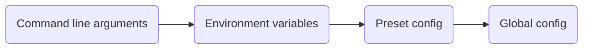

# Randomizer Anywhere - 100% TMX fork

This is a fork of [BigBang1112/randomizer-anywhere](https://github.com/BigBang1112/randomizer-anywhere), which downloads and starts a TrackMania dedicated server and runs a Random Map Challenge on it, controlled by in-game chat commands (for the original features, see his repo). This fork runs the three public servers of the [100% TMX Project](https://discord.gg/HRShWnzpK3) 24/7: TrackMania Nations Forever (TMNF), TrackMania United Forever (TMUF) and TrackMania Nations ESWC (the 2006 game, "TMN" in the config). Players get random maps that nobody has finished on [TMX](https://tmnf.exchange/) yet, and every finish with a valid replay helps to get the whole site finished.

Licensed under [AGPLv3](LICENSE). Source of this fork: https://github.com/cheatoskar/100-TMX-Server (players can get the link in-game with `/source`).

## What's different from the original

For players:
- Server-side leaderboard (`/top`, `/rank`)
- After every finish a replay download link that TMX accepts (TMX only takes server-saved replays)
- `/imp` and `/hard` reports with Discord webhook alerts, and a list of impossible maps that follows a shared, reviewed sheet (refreshed daily; maps taken off the sheet come back)
- `/map` and `/history` (also `-1` ... `-10` for past maps), `/afk`, `/rounds` for multilap maps
- Genre presets, switchable by an admin or by player vote (`/preset`, `/votepreset`); `/loadmap` and `/votemap` for a specific TMX map
- Clickable widgets (preset picker, vote popup, map info, history, top finishers) and a live status web page

Running 24/7:
- Offline copy of the map pool: if TMX is down, maps come from a local copy (small pools only)
- A small pool is played through once, every map one time, before any map comes again (saved in `played-maps.json`)
- Local skip list (`skipped-maps.json`) with `/blockmap`; changes are picked up while running
- Watchdog for maps that never start, timeouts on all calls to the game server, self-recovery when callbacks stop arriving
- Clean shutdown on SIGTERM (no orphaned dedicated server process)
- A `config.toml` that cannot be read stops the program with exit code 78 instead of running on defaults

Several servers on one machine:
- TMUF and ESWC instances next to TMNF, each with its own folder, config, ports and leaderboard (see [Running several servers](#running-several-servers))
- `deploy/deploy-when-empty.sh` updates every instance only after it has been empty for a while, and rolls back if the new build does not come up healthy

ESWC (old 2006 server) specifics:
- The old server sends no status or checkpoint callbacks, so status and finishes are polled once a second; a finish counts once, even when its finish callback arrives as well
- No widgets, no `/afk`; all info goes to the chat, and links are sent as plain URLs because the old chat has no `$l` links
- The old server cannot save a replay TMX accepts, so players get a chat hint about the [eswc-autosave](https://github.com/cheatoskar/eswc-autosave) mod instead of a download link

## For players

Chat commands (case does not matter). "Admin" means: restricted to `AdminLogins` if that is set in the config; if it is empty, everyone may use it.

| Command | Description |
| --- | --- |
| `/start` | Starts a new randomizer session and queues the first random map (admin). |
| `/stop`, `/end` | Stops the active session and resets the current map (admin). |
| `/skip` | Skips the current map for a new random one. |
| `/imp` | Skips the current map and reports it to Discord for review. It does not keep the map out: that happens only once the review puts it on the shared impossible-maps sheet. `/imp -1`, `/imp -2`, ... reports a past map instead (see `/history`). One report per player per minute; a map already reported during this run is not posted to Discord again. |
| `/hard` | Flags the current map as hard for review, without excluding it. Reports to Discord. `/hard -1`, ... flags a past map. Same cooldown as `/imp`. |
| `/rounds` | Switches the current map to Rounds mode if it is a genuine multilap map, so a full finish produces a TMX-valid replay. Reverts to TimeAttack when the map ends. Once per map, and not while the next map is already loading. |
| `/top` | Shows the top finishers on this server. |
| `/rank` | Shows your own rank and finish count. |
| `/afk` | Puts you into spectator mode and frees your slot; `/afk` again puts you back into the race (if a slot is free). Not on ESWC. |
| `/map` | Shows the current map's TMX link. `/map -1`, ... shows a past map. |
| `/history` | Lists the last maps and what `-1`, `-2`, ... refer to for `/map`, `/imp`, `/hard`, `/blockmap`. |
| `/timelimit`, `/tl <seconds>` | Shows or sets the session time limit (only while no session is active). |
| `/preset <name>` | Applies a bundled preset directly (admin; only while no session is active). |
| `/presets` | Lists the presets for this server's game and opens a clickable widget to vote for one. |
| `/votepreset <name>` | Starts a vote to switch preset; others support it with `/yes` (or the Yes/No widget) within the vote window. Without a name it opens the preset list like `/presets`. |
| `/loadmap <TMX id>` | Loads a specific TMX map by id, no vote (admin). |
| `/votemap <TMX id>` | Starts a vote to load a specific TMX map; shows name, author, difficulty, awards, author time and style tags first. Finishes on a map loaded this way (or with `/loadmap`) don't count for the leaderboard. |
| `/blockmap [-1..-10]` | Adds the current (or a past) map to this server's own skip list (`skipped-maps.json`) and skips it now. For maps that can't be played here. Permanent, local to the server, never sent to Discord (admin). |
| `/yes`, `/no` | Supports or withdraws support from an active preset or map vote. The skip vote with several players is TrackMania's own vote (F5). |
| `/info`, `/help` | Shows a summary of what the server can do. |
| `/commands` | Lists every raw command name. |
| `/source` | Links to the source code of this fork (AGPLv3). |
| `/testhud` | Diagnostic: displays a test manialink to check that widgets render for your client. |

The built-in web server (`ReplayServerPort`) also serves a status page at `/`: current map with TMX preview image, active preset, who is racing, and the top finishers. `/status.json` has the same data as JSON.

## For server operators

### Installation

A .NET console app, no builds are distributed; the live servers run from source builds.

1. Install the [.NET SDK](https://dotnet.microsoft.com/download) matching the project.
2. Clone this repository.
3. Run it from the repository root:

```
dotnet run --project RandomizerAnywhere -- --dedicated
```

On the first start the app copies `config.default.toml` to `config.toml` next to the program (the build output folder) if there is none; edit that copy. With `--dedicated` it downloads and starts the dedicated server, the web server and the weekly map-pool copy. Without `--dedicated` it only connects to a dedicated server that is already running.

The server then shows up in the game's "Local network" menu, or on the internet once `Lan = false` and `PublicHost` are set.

### `config.toml`

`RandomizerAnywhere/config.default.toml` is the annotated template. The basics are `Game`, `TmxGame`, `BindIP`, `XmlRpcPort`, `AutoSkipMode`, `Preset`, `GameSettings`, `AutoStart` and `CallVoteOnFinish`; further keys:

| Key | Description |
| --- | --- |
| `TimeLimit` | Session time budget in milliseconds. `0` = unlimited, the session only advances on finish or `/skip`. |
| `AdminLogins` | Comma-separated logins allowed to use the admin commands. Empty = everyone is admin. |
| `ServerName` | Plain-text server name. Also the replay folder name and what the status page shows. |
| `ServerDisplayName` | Name in the server list, with `$` format codes. Empty = `ServerName`. The 2006 server keeps only 25 characters, codes included. |
| `ServerComment`, `WelcomeMessage` | Shown in the server browser; multi-line chat message sent to everyone on connect. |
| `ReplayServerPort` | Port of the built-in web server (replay links, status page). Open it in your firewall. |
| `PublicHost` | Public hostname/IP used to build replay and status links. Empty falls back to `localhost`; set it on an internet-facing server. |
| `Lan` | `true` = LAN only, no masterserver registration; `false` for a real server. |
| `DiscordWebhookUrl`, `DiscordWebhookUrlHard` | Webhooks for `/imp` and `/hard`. Empty `...Hard` = both go to the first one; both empty = no alerts. |
| `ServerPort`, `ServerP2PPort` | Game and peer-to-peer port of this instance. `0` = keep the dedicated server's `dedicated_cfg.txt` value. |
| `ServerLogin`, `ServerPassword`, `ServerValidationKey` | Server account. Empty = keep the `dedicated_cfg.txt` values. |
| `ServerNation` | Old TM server only: nation of the master server account (for Nations the account is created on the first online start). |
| `ConnectionUploadRate` | Upload budget in kbit/s written into `dedicated_cfg.txt` at every start. Every joining player downloads the map through it. `0` = leave the file alone (TMF ships `512`). |
| `DisableVerboseRpc` | `true` starts the dedicated server without `/verbose_rpc`. Leave it off normally: the ConsoleLog is the only record of whether a call reached the server. |
| `KeepConsoleLogs` | How many `ConsoleLog.<pid>.txt` files to keep. Default `30`. |
| `LeaderboardFile` | Path of the leaderboard file; empty = `leaderboard.json` next to the program. Servers pointing at the same file share one leaderboard. |
| `[DownloadUrls]`, `[DownloadSha256]` | Where to download the `TMF` / `TM` dedicated server zip, and an optional SHA-256 per type; a zip that does not match is refused. |
| `[TmxQuery]` | Default TMX filters (a preset replaces them). |

### Presets

A preset is a `.toml` file in `RandomizerAnywhere/Presets/` that bundles a game, a TMX query and an auto-skip mode. Set `Preset = "<name>"` in `config.toml` to start with one. Players list and vote with `/presets` and `/votepreset`, admins switch with `/preset`. Each server only offers the presets for its own game. Every preset that draws from TMX excludes Unlimiter maps (`inunlimiter = 0`).

| TMNF | Display name | Key features |
| --- | --- | --- |
| `100tmx_tmnf` | 100% TMX Project (TMNF) | Maps without a record - the default |
| `short_lol_tmnf` | Short & LOL | Tags 6,1 (LOL/Stunt), author time at most 45 s |
| `lunatic_tmnf` | Lunatic | Difficulty 3 (Lunatic) |
| `rpg_tmnf` | RPG Together | Tags 9,11 (RPG, Trial) |
| `fullspeed_tmnf` | Fullspeed | Tag 5 |
| `tech_tmnf` | Tech | Tags 7,8 |
| `multilap_tmnf` | Multilap | Tags 4,14,16 (`/rounds` still needed per map for a valid replay) |
| `impossible_review_tmnf` | Impossible Review | Cycles only through maps flagged via `/imp`, for review; no auto-skip |

| TMUF | Display name | Key features |
| --- | --- | --- |
| `100tmx_tmuf` | 100% TMX Project (TMUF) | Maps without a record, all environments |
| `100tmx_tmuf_snow`, `_desert`, `_rally`, `_island`, `_coast`, `_bay`, `_stadium` | 100% TMX Project (TMUF Snow, ...) | Same, one environment (TMX `environment` filter, 0-based: 0 Snow, 1 Desert, 2 Rally, 3 Island, 4 Coast, 5 Bay, 6 Stadium) |
| `short_lol_tmuf`, `lunatic_tmuf`, `rpg_tmuf`, `fullspeed_tmuf`, `tech_tmuf`, `multilap_tmuf` | as for TMNF | Same filters as the TMNF presets |

| TMN (ESWC) | Display name | Key features |
| --- | --- | --- |
| `100tmx_tmn` | 100% TMX Project (ESWC) | Maps without a record |
| `short_lol_tmn`, `lunatic_tmn`, `fullspeed_tmn`, `tech_tmn` | as for TMNF | Same filters as the TMNF presets |

To add a preset, put a `<name>.toml` into `Presets` (copy `100tmx_tmnf.toml`). TMX genre filters use the `tag` query parameter, not `primarytype`, which 404s on `/trackrandom` for any nonzero value. See the comments in the bundled presets for known-good tag and difficulty values.

### Running several servers

One machine can host several servers, each from its own folder with its own config, leaderboard and skip list. Files for the two extra instances are in `deploy/`:

| | TMNF | TMUF (`deploy/tmuf/`) | ESWC (`deploy/eswc/`) |
| --- | --- | --- | --- |
| Game / P2P port | 2350 / 3450 | 2351 / 3451 | 2352 / 3452 |
| XML-RPC port | 5000 | 5001 | 5002 |
| Status page port | 8090 | 8091 | 8092 |
| Preset | `100tmx_tmnf` | `100tmx_tmuf` | `100tmx_tmn` |
| systemd unit | - | `100tmx-tmuf.service` | `100tmx-eswc.service` |
| Setup script | - | `setup-tmuf.sh` | `setup-eswc.sh` |

Each folder has a `config.toml`, the systemd unit and a setup script, run on the server as root. The script copies the application build, writes the config (taking `PublicHost` and the Discord webhooks from the TMNF config) and installs the unit. It starts nothing.

- TMUF: afterwards fill in `ServerLogin`, `ServerPassword` and `ServerValidationKey` in the TMUF `config.toml`; the unit refuses to start without `ServerLogin`. Open the ports, then `systemctl enable --now 100tmx-tmuf`.
- ESWC: the script also creates a system user `tmxeswc` (the server does not run as root), generates the master server password, and opens the ports in iptables. Admin logins are not copied from TMNF; `AdminLogins = "-"` means nobody is admin until real ESWC logins are put in. Open the ports in your cloud firewall (XML-RPC 5002 stays closed), then `systemctl enable --now 100tmx-eswc`. The first start downloads the 2006 server and checks its SHA-256.

`deploy/deploy-when-empty.sh <build folder>` (with `DEPLOY_HOST=<user>@<server>`) uploads a new build, waits until each instance has been empty for two minutes, swaps the files, restarts the service and puts the old files back if the new build does not come up healthy.

### Command line options

```
RandomizerAnywhere [--game <game>] [--tmx-game <game>] [--tmx-query <query>] [--bind-ip <ip>] [--xmlrpc-port <port>] [--server-name <name>] [--dedicated] [--skip-setup] [--help]
```

| Option | Description |
| --- | --- |
| `--game`, `-g <game>` | `TMNF`, `TMUF`, `TMN`, `TMS` or `TMO`. Falls back to `Game` in `config.toml`, then asks interactively (without a terminal: config error). |
| `--tmx-game`, `-t <game>` | TMX site to use, if different from `--game`. |
| `--tmx-query`, `-q <query>` | Raw TMX query string; overrides the `TmxQuery` table and anything a preset sets. |
| `--bind-ip <ip>` | IP the dedicated server binds to. |
| `--xmlrpc-port <port>` | Port of the XML-RPC connection to the dedicated server. |
| `--server-name <name>` | Server name. |
| `--dedicated` | Download, configure and start the dedicated server (plus web server and map-pool copy). |
| `--skip-setup` | With `--dedicated`: skip the download and start, i.e. use a dedicated server that already runs. |
| `--help`, `-h` | Show usage. |

### Environment variables

Each variable overrides the same setting in `config.toml`; the command line option, where there is one, overrides the variable. Booleans are set to `true`.

- Equivalent to a command line option: `RANDANY_GAME`, `RANDANY_TMX_GAME`, `RANDANY_BIND_IP`, `RANDANY_XMLRPC_PORT`, `RANDANY_SERVER_NAME`, `RANDANY_DEDICATED`, `RANDANY_SKIP_SETUP`
- Equivalent to a `config.toml` key: `RANDANY_AUTO_SKIP_MODE` (`AuthorMedal`, `GoldMedal`, `SilverMedal`, `BronzeMedal`, `Finished` or `None`), `RANDANY_CALLVOTE_ON_FINISH`, `RANDANY_SERVER_DISPLAY_NAME`, `RANDANY_SERVER_COMMENT`, `RANDANY_GAMESETTINGS`, `RANDANY_AUTO_START`, `RANDANY_ADMIN_LOGINS`, `RANDANY_PUBLIC_HOST`, `RANDANY_REPLAY_SERVER_PORT`, `RANDANY_LAN`, `RANDANY_SERVER_PORT`, `RANDANY_SERVER_P2P_PORT`, `RANDANY_SERVER_LOGIN`, `RANDANY_SERVER_PASSWORD`, `RANDANY_SERVER_VALIDATION_KEY`, `RANDANY_SERVER_NATION`, `RANDANY_LEADERBOARD_FILE`, `RANDANY_DISCORD_WEBHOOK_URL`, `RANDANY_DISCORD_WEBHOOK_URL_HARD`

### Configuration precedence

When the same setting is given in more than one place, the first of these wins:



The final state is written into the session data for leaderboard filters.

## Development Note

This mod was developed with the help of [Claude Code](https://claude.com/claude-code). The ideas, presets, design and testing are my own, with AI assisting throughout the development process. If you find a bug, please report it in the [issues](https://github.com/cheatoskar/100-TMX-Server/issues).

---

## Special thanks

- To [BigBang1112](https://github.com/BigBang1112), for building Randomizer Anywhere and Randomizer TMF before it
- To Flink and Greep, for inventing the challenge
- To the TMX maintainers that make this possible!
